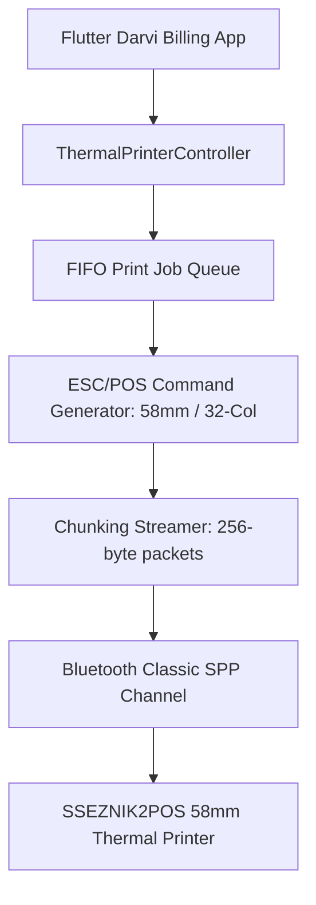

# QuickStock POS Source Code Audit: Bluetooth & Thermal Receipt Printing

**Document ID:** `docs/darvi-audit/BLUETOOTH_PRINTING_AUDIT.md`  
**Audit Date:** November 2026  
**Auditor:** Senior Mobile Hardware Specialist & Software Auditor  

---

## 1. Existing Printing Implementation Audit

In the QuickStock POS repository, receipt generation is handled in `lib/core/services/receipt_pdf_service.dart` and `lib/core/services/stub_services.dart`.

### A. The Stub Service (`lib/core/services/stub_services.dart`)
```dart
class StubPrinterService implements PrinterService {
  @override
  Future<void> printReceiptPdfBytes(List<int> bytes) async {
    // Stub for future ESC/POS Bluetooth implementation.
  }
}
```
- **Finding:** The printer service is a **completely empty stub**. The method body has no code.
- Calling `_receiptPdfService.printThroughStub(file)` does nothing.

### B. The PDF Printing Approach (`lib/core/services/receipt_pdf_service.dart`)
```dart
Future<void> printPdf(File file) {
  return Printing.layoutPdf(onLayout: (_) => file.readAsBytes());
}
```
- **Finding:** When a user taps "Print receipt" on the POS screen, the app calls `Printing.layoutPdf()`.
- **What Actually Happens:** It invokes the standard **Android OS Print Spooler dialog**. The OS dialog expects network printers (Wi-Fi/Mopria/AirPrint) or virtual PDF generation.
- **Why It Fails for Thermal POS Printers:** Handheld Android POS terminals and commercial 58mm Bluetooth receipt printers (such as the **SSEZNIK2POS**) **do not register as Android OS Print Spooler services**. They communicate as serial stream devices over **Bluetooth Classic (RFCOMM / SPP - Serial Port Profile)**. Sending a raster PDF to a Bluetooth SPP port without rasterization or ESC/POS formatting will produce gibberish or fail completely.

---

## 2. Hardware Specification & Darvi Requirements

| Parameter | Current QuickStock Implementation | Darvi Billing Target Requirement (SSEZNIK2POS) | Status |
|---|---|---|---|
| **Hardware Device** | Unspecified / Android Print Spooler | **SSEZNIK2POS** Portable Thermal Printer | **MISSING** |
| **Paper Width** | 80mm (`PdfPageFormat.roll80`) | **58mm Thermal Roll** | **INCOMPATIBLE** |
| **Print Width / Columns** | Dynamic PDF canvas | **32 Columns** (Font A: 12x24) or **42 Columns** (Font B: 9x17) | **MISSING** |
| **Communication Protocol**| OS Print Manager Intent | **Bluetooth Classic RFCOMM (SPP - Serial Port Profile, UUID `00001101-0000-1000-8000-00805F9B34FB`)** | **MISSING** |
| **Data Format** | Vector PDF Byte stream | **Raw ESC/POS Byte Commands** | **MISSING** |
| **Android Permissions** | None in `AndroidManifest.xml` | `BLUETOOTH_SCAN`, `BLUETOOTH_CONNECT`, `ACCESS_FINE_LOCATION` | **DEFECT** |
| **Device Discovery** | None | Bluetooth device scan & paired device picker | **MISSING** |
| **Connection Lifecycle** | None | Auto-reconnect, keep-alive, disconnect handling | **MISSING** |
| **Chunked Transmission**| None | 100-500 byte packet chunking with 20ms delays | **MISSING** |
| **Print Queue** | None | FIFO async print spooler to prevent buffer overrun | **MISSING** |
| **Receipt Structure** | Basic PDF summary | Darvi Header, GSTIN, 32-col item rows, GST slab, Footer | **MISSING** |

---

## 3. Protocol Deep Dive: Bluetooth Classic (SPP) vs. BLE

Thermal receipt printers like the **SSEZNIK2POS** almost universally operate on **Bluetooth Classic RFCOMM / SPP**, NOT Bluetooth Low Energy (BLE).



### Why Bluetooth Classic (SPP) is Mandatory:
1. **Bandwidth & Throughput:** Printing a full receipt with logos, text, barcodes, and QR codes requires several kilobytes of data. BLE characteristic limits (typically 20-512 bytes MTU) throttle throughput and often cause buffer truncation on low-cost thermal microcontrollers.
2. **Standard POS Socket:** The SSEZNIK2POS advertises the standard serial profile UUID:
   `00001101-0000-1000-8000-00805F9B34FB` (SerialPortServiceClass_UUID).
3. **Connection Mode:** Pairing is established once in Android OS Bluetooth settings, and the app connects directly to the paired MAC address (e.g., `00:11:22:33:44:55`).

---

## 4. Required Android Manifest & Runtime Permissions

On modern Android devices (Android 12+, API 31+), Bluetooth access requires explicit runtime permissions that are completely missing in `android/app/src/main/AndroidManifest.xml`:

```xml
<!-- Android 12+ Bluetooth Permissions -->
<uses-permission android:name="android.permission.BLUETOOTH_SCAN" 
    android:usesPermissionFlags="neverForLocation" />
<uses-permission android:name="android.permission.BLUETOOTH_CONNECT" />

<!-- Legacy Android (< 12) Permissions -->
<uses-permission android:name="android.permission.BLUETOOTH" 
    android:maxSdkVersion="30" />
<uses-permission android:name="android.permission.BLUETOOTH_ADMIN" 
    android:maxSdkVersion="30" />
<uses-permission android:name="android.permission.ACCESS_FINE_LOCATION" 
    android:maxSdkVersion="30" />
```

---

## 5. Darvi 58mm Receipt Formatting Specification (32 Columns)

Thermal paper of 58mm width formatted in standard Font A provides exactly **32 character columns**. Text layout must strictly align with this grid:

```
01234567890123456789012345678901
================================
     DARVI GROUP AGRI TECH      
#2 Totad Bldg, Arjun Vihar,     
Gokul Road, Hubli, Karnataka    
GSTIN: 29BKZPA0053M1ZQ          
Ph: 9986890777                  
================================
Inv: INV-20261107-0012          
Date: 07/11/2026 11:30 AM       
Cust: Ramesh Patil (Hubli)      
================================
Item             Qty Price Total
--------------------------------
Neem Cake 50kg     2   450   900
Bio Potash 1L      1   350   350
--------------------------------
Subtotal:               1,250.00
Disc:                     -50.00
Taxable:                1,200.00
CGST (9%):                 54.00
SGST (9%):                 54.00
--------------------------------
TOTAL:                ₹ 1,308.00
PAID (UPI):           ₹ 1,308.00
CHANGE:                     0.00
================================
Improving Agriculture,          
Improving lives.                
* Goods once sold will not be   
  taken back or exchanged.      
* No cash payments accepted.    
Thank you for your purchase!    
[ESC d 3: Feed 3 lines]         
[GS V 66 0: Partial Cut]        
```

---

## 6. Recommended Thermal Printing Architecture for Darvi Billing

1. **Do not use `printing` package for thermal receipts.** Retain `printing` only for A4 invoice generation or office printers.
2. **Adopt an ESC/POS Byte Generator:** Use an established Dart ESC/POS command builder (such as `esc_pos_utils_plus: ^2.0.4`) to format text, alignment, bolding, tables, and barcode/QR commands directly into byte buffers.
3. **Bluetooth Classic Streamer:** Integrate a proven Bluetooth Classic SPP library (such as `flutter_bluetooth_serial` or a dedicated lightweight native Android Platform Channel) to open RFCOMM sockets, scan paired devices, monitor connection health, and transmit packets in 256-byte chunks with 20ms pacing.
4. **Hardware Diagnostic Screen:** Implement a "Printer Management" screen in Darvi Settings allowing the user to scan Bluetooth devices, select the SSEZNIK2POS printer, save its MAC address to `AppSettings`, and run a 1-tap "Test Print".

