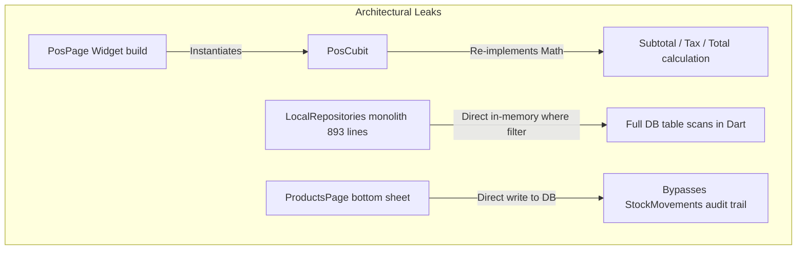

# QuickStock POS Source Code Audit: Code Quality & Architectural Integrity

**Document ID:** `docs/darvi-audit/CODE_QUALITY_AUDIT.md`  
**Audit Date:** November 2026  
**Auditor:** Senior Software Architect & Code Auditor  

---

## 1. Clean Architecture & Separation of Concerns

QuickStock POS demonstrates good structural intent by organizing code into horizontal Clean Architecture layers:
- **Presentation:** Cubits + Pages + Reusable Widgets
- **Domain:** Pure Dart Entities + Abstract Repository Interfaces
- **Data:** Drift SQLite DB + Local Repository Implementations

However, a granular code quality audit reveals significant architectural leaks and anti-patterns:



### Key Architectural Deficiencies

1. **Lifecycle Mismatch in Cubit Provision:**
   - In `lib/features/pos/presentation/pages/pos_page.dart` (lines 26-36):
     ```dart
     return BlocProvider(
       create: (context) => PosCubit(...)..load(),
       child: const _PosView(),
     );
     ```
   - Because `PosCubit` is created inside the page's `build()` method under a GoRouter `ShellRoute`, every time the user navigates between bottom tabs, `PosCubit` is closed and recreated. Any items placed in the cart are immediately discarded.
2. **Duplication of Calculation Logic:**
   - `MoneyCalculator` exists to encapsulate math. However, `PosState` (in `pos_cubit.dart` lines 54-75) re-implements `subtotal`, `tax`, `total`, and `change` as dynamic getters that execute on every state inspection.
3. **Monolithic Repository Implementation:**
   - All local repositories (`LocalAuthRepository`, `LocalSettingsRepository`, `LocalProductRepository`, `LocalSalesRepository`, `LocalReportsRepository`, `LocalPartyRepository`) are crammed into a single 893-line file (`lib/data/repositories/local_repositories.dart`).
   - This violates the Single Responsibility Principle and complicates code maintenance.

---

## 2. File Size & Complexity Analysis

Files exceeding 300 lines of code in the existing codebase:

| File Path | Total Lines | Byte Size | Primary Complexity Source | Recommended Action |
|---|---|---|---|---|
| `lib/data/repositories/local_repositories.dart` | **893** | 29,175 | Bundles 6 distinct repositories and complex transactions in one file. | **Refactor into separate files:** `local_product_repo.dart`, `local_sales_repo.dart`, `local_reports_repo.dart`, etc. |
| `lib/features/products/presentation/pages/products_page.dart` | **548** | 24,065 | Contains product catalog view, add/edit product modal, stock adjustment modal, image pickers, and list tiles. | **Extract widgets:** `ProductEditorSheet`, `StockActionSheet`, `ProductFilterBar`. |
| `lib/features/pos/presentation/pages/pos_page.dart` | **520** | 20,162 | Houses responsive split layouts, category chips, cart pane, checkout bottom sheet, and action banners. | **Extract widgets:** `PosCartPane`, `PosCheckoutModal`, `PosSummaryBar`. |
| `lib/core/models/app_models.dart` | **508** | 11,119 | Combines all DTOs, enums, filter classes, and metric structures into a single file. | **Split by domain:** `product_models.dart`, `sale_models.dart`, `settings_models.dart`. |
| `lib/features/pos/presentation/cubit/pos_cubit.dart` | **398** | 12,753 | Handles filtering, cart mutations, checkout, PDF receipt generation, and printing triggers. | **Clean up:** Delegate receipt generation to service; fix `paid` state bug. |
| `lib/features/reports/presentation/pages/reports_page.dart` | **389** | 13,656 | Bundles 7 separate sub-cards into one page file. | **Extract cards into separate widget files.** |

---

## 3. Error Handling & Exception Management

In `lib/core/errors/app_exception.dart`:
```dart
class AppException implements Exception {
  AppException(this.message);
  final String message;
  @override
  String toString() => message;
}
```

### Deficiencies:
- **Single Flat Class:** There is only one generic `AppException`. There is no distinction between network errors, validation failures, database constraint violations, hardware/printer errors, or authentication failures.
- **Generic Catch Blocks:** Repositories and Cubits frequently employ broad `catch (e)` blocks that convert unexpected runtime exceptions (such as `NullThrownError` or SQLite foreign key exceptions) into unformatted raw strings shown directly to the user in the UI.
- **Silent Failures:** In `ReceiptPdfService` and `StubPrinterService`, errors during printing are swallowed or printed as stubs without actionable recovery prompts.

---

## 4. Null Safety & Type Safety Assessment

1. **Sound Null Safety:** The entire codebase is written with sound null safety. No `!` assertions trigger obvious crash bugs on startup.
2. **Nullable Misuse:**
   - In `ProductUpsertInput`, `barcode`, `categoryId`, `notes`, and `imagePath` are correctly marked nullable.
   - However, in `LocalProductRepository.getProducts()`, null checking on category names defaults to `categoryMap[row.categoryId]`, which can silently yield `null` without fallback handling in the UI (rendered as `-`).
3. **Lack of Enforced Foreign Key Constraints:**
   - While Drift supports foreign key cascades (`onDelete: KeyAction.cascade`), SQLite foreign key pragma enforcement must be enabled explicitly at connection time (`PRAGMA foreign_keys = ON;`). In `app_database.dart`, this pragma is **not verified**, meaning SQLite may default to ignoring foreign key constraints on older Android platforms.

---

## 5. Hardcoded Constants & Localization Integrity

1. **Hardcoded Currency & Business Details:**
   - Default currency is hardcoded to `'EGP'` (Egyptian Pound) across `AppSettingsModel.fallback`, `formatters.dart`, and `seed_data.dart`.
   - Default store name is hardcoded to `'Mini Store'` / `'Mini Mart'`.
   - Default tax rate is hardcoded to `0.14` (14%).
   - Default credentials are hardcoded to PIN `'1234'` and password `'admin123'`.
2. **Localization Coverage:**
   - `AppLocalizations` contains a static English and Arabic dictionary.
   - While basic POS terms are translated, newer UI additions (such as image picker sheets and stock action titles) contain hardcoded English strings that bypass `context.l10n.tr()`.
   - Kannada and Hindi are completely absent.

