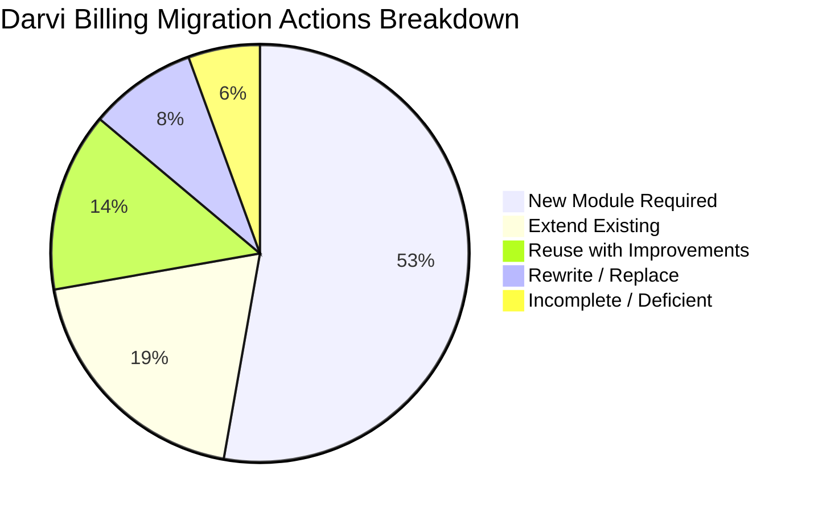

# QuickStock POS to Darvi Billing: Master Feature Gap Matrix

**Document ID:** `docs/darvi-audit/DARVI_FEATURE_GAP_MATRIX.md`  
**Audit Date:** November 2026  
**Auditor:** Senior Flutter Architect & Software Auditor  

---

## 1. Master Feature Comparison Table

The following matrix audits all 36 core modules and business extensions required for **Darvi Billing** against the existing QuickStock POS implementation:

| # | Feature / Module | Existing Implementation in QuickStock | Current Status | Darvi Billing Target Requirement | Recommended Action | Technical Justification |
|---|---|---|---|---|---|---|
| **1** | **Dashboard** | `ReportsPage` renders 4 metric cards (`TodaySales`, `MonthSales`, `TodayProfit`, `MonthProfit`), best sellers, and low-stock items. | Functional but basic | Multi-metric executive dashboard with revenue trends, pending receivables, payables, staff targets, and low-stock alerts. | **Reuse with improvements** | The existing card layout is visually clean; upgrade data aggregation from memory-loading to fast SQL queries and add receivables/payables cards. |
| **2** | **Sales & POS** | `PosPage` + `PosCubit` with search, barcode scan, category filter, cart, discount, payment modal, checkout transaction. | Functional with flaws | High-speed agricultural retail billing with customer selection, GST breakdown preview, cash tenders, and employee attribution. | **Reuse with improvements** | Core cart and checkout flow works well; fix the `paid: state.total` bug, add customer picker to checkout modal, and attribute sales staff. |
| **3** | **Invoices** | `InvoiceDetailPage` displaying line items, pricing snapshots, and partial/full return selectors. | Functional | Comprehensive invoice management with search, filter, thermal receipt re-printing, WhatsApp PDF share, and cancel/return logs. | **Reuse with improvements** | Retain data model; add re-print thermal receipt button, share via WhatsApp, and display customer GSTIN. |
| **4** | **Quotations / Estimates** | Completely absent. | **Missing** | Create, view, convert quotations to sales invoices without deducting inventory until converted. | **New module required** | Requires `Quotations` and `QuotationItems` tables and dedicated creation/conversion UI. |
| **5** | **Products & Catalog** | `ProductsPage` + `ProductsCubit` with full CRUD, Unsplash/camera images, SKU, barcode, category assignment, cost, and price. | Functional | Agricultural catalog with HSN codes, GST tax slabs (0%, 5%, 12%, 18%, 28%), batch numbers, expiry dates, and bulk import. | **Extend** | Product entity is strong; add HSN code and GST rate fields to `Products` table and provide category creation inside the UI. |
| **6** | **Inventory Management** | `StockMovements` table with add/remove/adjust tracking and low-stock threshold alerts. | Functional with leaks | Transaction-safe batch inventory tracking, minimum reorder levels, stock valuation (FIFO/Weighted Average), and audit trail. | **Extend** | Fix product editor direct-overwrite leak; ensure every stock change logs a `StockMovement`; add stock valuation reports. |
| **7** | **Purchases** | Single-item `Purchases` table; `LocalProductRepository.addStockMovement(type: purchase)`. Zero UI. | Incomplete (No UI) | Multi-item supplier purchase bills with tax breakdown, transport charges, payment terms, and automated inventory inwarding. | **Rewrite data model & Build new UI** | Replace single-item `Purchases` table with `PurchaseInvoices` and `PurchaseInvoiceItems` parent-child schema and build full purchase entry UI. |
| **8** | **Customers** | `Customers` table (`id, name, phone, notes, balance`) and `LocalPartyRepository`. Zero UI. | Incomplete (No UI) | Comprehensive customer directory with GSTIN, billing/shipping address, agricultural landholding details, and credit limit. | **Extend DB & Build new UI** | Retain table foundation; add GSTIN and address fields; build customer list, search, and edit pages. |
| **9** | **Suppliers** | `Suppliers` table (`id, name, phone`) and `LocalPartyRepository`. Zero UI. | Incomplete (No UI) | Vendor directory with GSTIN, bank details, contact person, payment terms, and purchase history. | **Extend DB & Build new UI** | Add GSTIN, bank details, and address to `Suppliers`; build supplier list and management screens. |
| **10**| **Customer Ledger** | In-place update of `customer.balance` column. Zero transaction history. | Incomplete (No Ledger) | Full double-entry customer statement showing invoices, payments, credit notes, running balances, and PDF statement generation. | **New module required** | Must create a proper `LedgerEntries` table; build customer ledger view with date filters and statement export. |
| **11**| **Supplier Ledger** | Completely absent (no balance column on `Suppliers`). | **Missing** | Supplier payables ledger tracking inward bills, payments made, debit notes, and outstanding dues. | **New module required** | Relies on `LedgerEntries` table; build supplier ledger view with payment voucher recording. |
| **12**| **Expenses Management** | Completely absent. | **Missing** | Categorized expense recording (rent, electricity, freight, labor, tea/refreshments) with receipt attachments and account deduction. | **New module required** | Requires `ExpenseCategories`, `Expenses` tables, and expense entry/summary screens. |
| **13**| **Payments & Accounts** | Hardcoded `PaymentMethod { cash, card, split }` enum. Zero account entities. | Incomplete | Multi-account management: Cash in Hand drawer, Company Bank Accounts, UPI merchant accounts, and inter-account transfers. | **New module required** | Create `Accounts` and `Payments` tables; track real balances in each account when sales, purchases, or expenses are recorded. |
| **14**| **Cash & Bank Accounts** | Completely absent. | **Missing** | Live cash drawer reconciliation (opening float, day cash sales, day expenses, closing cash count) and bank balance tracking. | **New module required** | Add cash reconciliation workflow to daily closing routine. |
| **15**| **Financial Reports** | Today/Month revenue, profit, best sellers, and sales-by-product progress bars. | Functional but basic | P&L statement, balance sheet preview, daily sales register, inventory valuation summary, and expense breakdown. | **Extend** | Upgrade reports with SQL aggregations, add export to PDF/Excel, and integrate expense deductions into net profit. |
| **16**| **GST Reports** | Single flat `taxTotal` column on sales; no GST breakup or HSN summaries. | Incomplete | Indian GST compliance reports: GSTR-1 (B2B, B2C, HSN summary), GSTR-3B monthly tax summary, CGST/SGST/IGST breakdown. | **New module required** | Add GST calculation engine and GSTR export tables. |
| **17**| **Staff Management** | Single Cashier PIN and single Admin Password in settings. | Deficient | Multi-employee directory with employee profiles, contact details, emergency info, and role assignment. | **New module required** | Build `Employees` module with dedicated staff listing and profile creation. |
| **18**| **Employee Profiles** | Completely absent. | **Missing** | Detailed profiles: Employee ID, designation, department, joining date, salary structure, and status. | **New module required** | Implemented as part of Staff module. |
| **19**| **Roles & Permissions**| Hardcoded `UserRole { admin, cashier }` check. | Incomplete | Configurable permission sets (Billing, Inventory, View Costs, Edit Prices, Reports, Master Settings). | **Extend** | Implement capability-based permission model tied to active employee session. |
| **20**| **Staff Attendance** | Completely absent. | **Missing** | Daily staff check-in / check-out logging, working hours calculation, and monthly attendance calendar. | **New module required** | Requires `Attendance` table and quick clock-in/out UI. |
| **21**| **Staff Payroll** | Completely absent. | **Missing** | Monthly salary computation integrating base pay, attendance deductions, earned sales incentives, and advance salary deductions. | **New module required** | Build payroll generation engine and salary slip voucher generator. |
| **22**| **Incentive Management**| Completely absent. | **Missing** | Configurable commission rules: revenue % commission, product-specific bonuses, sales target tier accelerators. | **New module required** | Create `IncentiveRules` and `IncentiveClaims` tables; compute commissions upon invoice checkout. |
| **23**| **Staff Performance** | Completely absent. | **Missing** | Employee performance dashboard: sales target achievement %, total volume billed, customer retention, incentive earned. | **New module required** | Add staff analytics tab to Reports module. |
| **24**| **CRM Leads** | Completely absent. | **Missing** | Agricultural prospective customer tracking: farmer name, contact, crop type, acre size, interested products, and lead status. | **New module required** | Build lightweight CRM pipeline (New, Contacted, Proposal, Converted, Lost). |
| **25**| **Follow-up Management**| Completely absent. | **Missing** | Scheduled follow-up reminders with calendar notifications for farmer field visits or agronomy recommendations. | **New module required** | Add follow-up task scheduler. |
| **26**| **Vikshha Plot Management**| Completely absent. | **Missing** | Darvi specialized module: Managing agricultural farm plots, boundary details, crop cycles, soil test logs, and input schedules. | **New module required** | Build custom Vikshha Plot entity linked to customer profiles. |
| **27**| **Customer Plot Registration**| Completely absent. | **Missing** | Mapping customer farmers to registered land plots with GPS coordinates, survey numbers, and plantation dates. | **New module required** | Built in conjunction with Vikshha module. |
| **28**| **Shipping Labels** | Completely absent. | **Missing** | Printing standard 4x6" shipping labels or 58mm package dispatch slips with barcode, sender (Darvi), and customer address. | **New module required** | ESC/POS label command generator. |
| **29**| **Historical Migration**| Unsplash sample products and demo customers in `SeedData`. | Demo seed only | Automated migration tool to import existing customer lists, product catalogs, and opening balances from CSV/Excel. | **Extend** | Replace `SeedData` with a robust CSV data import wizard. |
| **30**| **Multi-Workspace** | Single-store database architecture (`mini_pos_inventory.sqlite`). | **Missing** | Support multiple separate business entities/workspaces with isolated ledgers, inventory, and GSTINs. | **Extend DB & Architecture** | Add `Workspaces` table; partition all business data with `workspaceId`. |
| **31**| **Bluetooth Printer Config**| `StubPrinterService` (empty stub) + OS print dialog. | Incomplete / Stub | Hardware settings screen to scan, pair, select, and test the SSEZNIK2POS thermal printer. | **Rewrite Printer Layer** | Build `PrinterService` with Bluetooth Classic SPP discovery and device selector UI. |
| **32**| **Printer Pairing & Link**| Completely absent. | **Missing** | Seamless Bluetooth connection manager with auto-reconnect and link health monitoring. | **New module required** | Integrated into Bluetooth hardware engine. |
| **33**| **58mm Thermal Receipts**| 80mm PDF roll using `pdf` package. | Incompatible format | 32-column ESC/POS raw thermal receipt with Darvi header, GSTIN, item rows, GST slab, and statutory terms. | **New module required** | Direct byte-level ESC/POS formatter adhering to 32 columns. |
| **34**| **Print Queue & Spooler**| Direct async call to stub. | Non-existent | Thread-safe FIFO print queue preventing buffer overflow and dropped receipts on handheld terminals. | **New module required** | Dedicated Dart Stream-based print queue. |
| **35**| **Test Print Utility** | Completely absent. | **Missing** | 1-tap test print sending character alignment, font styles, and cutter test to verify printer readiness. | **New module required** | Integrated into Printer Settings screen. |
| **36**| **Print Diagnostics** | Completely absent. | **Missing** | Connection status banner, error logging, and retry modal if printer is out of paper or disconnected. | **New module required** | Integrated into hardware service. |

---

## 2. Summary by Action Category

- **Reuse with Improvements (5 modules):** Dashboard UI, Sales & POS core cart, Invoices viewer, Settings base, Barcode scanner.
- **Extend Existing (7 modules):** Product catalog, Inventory movements, Customers table, Suppliers table, App dependencies, Theme/Styling, Reports.
- **Rewrite / Replace (3 modules):** Purchases data model, Local repositories monolith, Thermal printing engine.
- **New Modules Required (19 modules):** Quotations, Customer Ledger, Supplier Ledger, Expenses, Cash & Bank Accounts, Cash Drawer, GST Reports, Staff Directory, Employee Profiles, Roles & Permissions, Attendance, Payroll, Incentive Rules & Claims, Staff Performance, CRM Leads, Follow-ups, Vikshha Plot Management, Multi-Workspace Isolation, Bluetooth Hardware Controller.

