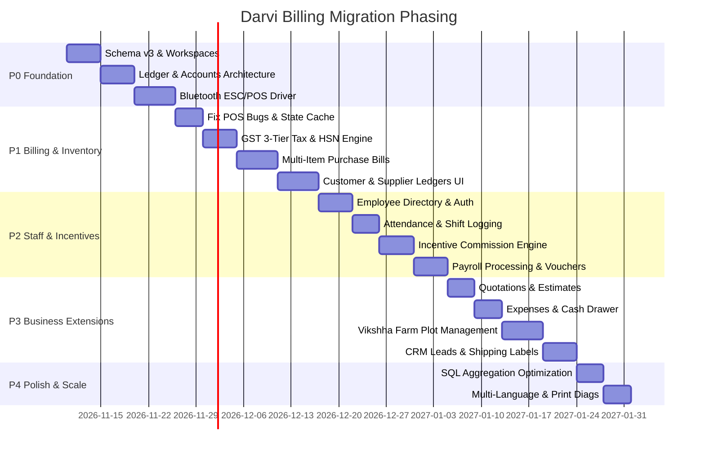

# Darvi Billing: Phased Implementation Roadmap

**Document ID:** `docs/darvi-audit/DARVI_IMPLEMENTATION_ROADMAP.md`  
**Audit Date:** November 2026  
**Auditor:** Senior Flutter Architect & Software Auditor  

---

## 1. Roadmap Overview & Phasing Philosophy

The implementation of **Darvi Billing** follows a strict, risk-minimized, phased sequence prioritizing **P0 (Critical Foundation)** through **P4 (Polish & Optimization)**.

No UI or peripheral features are developed before the foundational data models, ledger integrity, and hardware drivers are proven stable.

---

## 2. Granular Priority Breakdown

### P0 — Critical Foundation (Mandatory Prerequisites)

| Task ID | Milestone Name | Exact Technical Scope | Primary Files Affected | Validation Gate |
|---|---|---|---|---|
| **P0-1** | **Normalize Toolchain & Environment** | Fix SDK constraint in `pubspec.yaml` to `sdk: '>=3.3.0 <4.0.0'`. Create missing `assets/` directory. Configure Android package namespace to `com.darvi.billing`. | `pubspec.yaml`, `android/app/build.gradle.kts`, `AndroidManifest.xml` | `flutter pub get` resolves with zero warnings. |
| **P0-2** | **Database Schema v3 Migration** | Upgrade `AppDatabase.schemaVersion` to 3. Create tables: `Workspaces`, `LedgerEntries`, `Accounts`, `Payments`. Add `workspaceId` foreign key across existing tables. Seed Darvi Group Agri Tech identity. | `app_database.dart`, `app_database.g.dart` | Automated Drift migration test passes without data loss from v2. |
| **P0-3** | **Modularize Repository Layer** | Split the 893-line `local_repositories.dart` monolith into distinct files: `local_product_repository.dart`, `local_sales_repository.dart`, `local_ledger_repository.dart`, `local_workspace_repository.dart`. | `lib/data/repositories/` | Existing unit tests continue passing without regression. |
| **P0-4** | **Android Bluetooth SPP Thermal Driver** | Add Bluetooth permissions to `AndroidManifest.xml`. Implement Bluetooth Classic RFCOMM SPP socket streamer with 256-byte chunking and 20ms delays. Build 32-column ESC/POS byte generator for 58mm paper. | `lib/core/services/thermal_printer_service.dart`, `AndroidManifest.xml` | Successful test print sent to SSEZNIK2POS printer. |

---

### P1 — Essential Billing & Inventory

| Task ID | Milestone Name | Exact Technical Scope | Primary Files Affected | Validation Gate |
|---|---|---|---|---|
| **P1-1** | **Fix POS State Machine & Cart Lifespan** | Resolve the `paid: state.total` bug in `PosCubit`. Move `PosCubit` to persistent dependency injection or upgrade to `StatefulShellRoute` so cart survives tab switches. Fix duplicate item stock overwrite. | `pos_cubit.dart`, `app_router.dart`, `pos_page.dart` | Multi-item checkout accurately sets tendered cash and deductions. |
| **P1-2** | **Indian GST 3-Tier Engine & HSN Support** | Add `hsnCode` and `gstRate` to `Products`. Implement CGST, SGST, IGST tax breakdown in `MoneyCalculator`. Display tax slabs on cart and printed receipt. | `money_calculator.dart`, `products_page.dart`, `receipt_pdf_service.dart` | Tax calculation matches Indian GST invoice rules to the exact paisa. |
| **P1-3** | **Customer Selection & Ledger Integration** | Expose customer search and quick-create in POS checkout modal. Every credit sale (`paid < total`) logs an entry into `LedgerEntries` instead of just an in-place balance bump. | `pos_page.dart`, `local_sales_repository.dart`, `local_ledger_repository.dart` | Customer statement reflects exact sale amount, amount paid, and balance due. |
| **P1-4** | **Multi-Item Purchase Bills** | Create `PurchaseInvoices` and `PurchaseInvoiceItems` tables. Build Purchase entry view with supplier picker, multi-item table, inward stock adjustment, and supplier payables ledger logging. | `app_database.dart`, `purchase_page.dart`, `purchases_cubit.dart` | Supplier bill updates inventory count and supplier balance in one transaction. |
| **P1-5** | **Customer & Supplier Directory Views** | Create dedicated UI views for Customers and Suppliers under the main navigation shell, with search, phone call action, GSTIN lookup, and ledger statement tab. | `customer_list_page.dart`, `supplier_list_page.dart` | Users can view party balance and transaction history. |

---

### P2 — Employee, Payroll & Incentives

| Task ID | Milestone Name | Exact Technical Scope | Primary Files Affected | Validation Gate |
|---|---|---|---|---|
| **P2-1** | **Staff Directory & Individual Auth** | Create `Employees` table with employee IDs, phone, role, base salary, and unique login PIN. Replace hardcoded login with individual staff PIN authentication. | `employees_page.dart`, `login_page.dart`, `app_cubit.dart` | Different staff members log in with their own PINs; sales attribute to their ID. |
| **P2-2** | **Daily Staff Attendance** | Build attendance logging screen with 1-tap Clock-In and Clock-Out. Record timestamps and compute daily working hours. | `attendance_page.dart`, `attendance_cubit.dart` | Monthly attendance grid calculates present/absent days. |
| **P2-3** | **Incentive & Commission Rules** | Create `IncentiveRules` (Revenue % or Product-specific ₹ bonus) and `IncentiveClaims`. Calculate staff commissions on POS checkout. | `incentive_rules_page.dart`, `pos_cubit.dart` | Real-time tracking of staff sales targets and commission accrued. |
| **P2-4** | **Payroll Processing & Vouchers** | Monthly payroll engine computing Base Salary + Incentives - Deductions. Generates salary vouchers and deducts company Cash/Bank balance. | `payroll_page.dart`, `payroll_cubit.dart` | Disbursing salary creates a debit entry in Cash/Bank ledger. |

---

### P3 — Advanced Darvi Business Modules

| Task ID | Milestone Name | Exact Technical Scope | Primary Files Affected | Validation Gate |
|---|---|---|---|---|
| **P3-1** | **Quotations & Estimates** | Create `Quotations` module allowing draft bills to be issued to farmers, printed or shared on WhatsApp, and converted to invoices with 1 tap. | `quotations_page.dart`, `quotations_cubit.dart` | Quotation conversion generates sale and deducts inventory seamlessly. |
| **P3-2** | **Expenses & Cash Drawer Reconciliation** | Record daily store expenses by category. Add day opening float and day closing cash drawer reconciliation modal. | `expenses_page.dart`, `cash_drawer_page.dart` | Net store cash matches system calculated total. |
| **P3-3** | **Vikshha Farm Plot Management** | Create `VikshhaFarmPlots` table mapping farmer customers to land plots with survey numbers, acre size, crop types, and soil test logs. | `vikshha_plots_page.dart` | Agronomy advice and product purchase history linked to specific farm plots. |
| **P3-4** | **CRM Leads & Shipping Labels** | Lightweight sales lead tracker for prospective farmers. 58mm / 4x6" shipping package dispatch label generator for agricultural deliveries. | `crm_leads_page.dart`, `shipping_label_service.dart` | High-density ESC/POS shipping label prints cleanly. |

---

### P4 — Optimization, Polish & Diagnostics

| Task ID | Milestone Name | Exact Technical Scope | Primary Files Affected | Validation Gate |
|---|---|---|---|---|
| **P4-1** | **SQL Query & Aggregation Optimization** | Replace all in-memory `sales.where(...)` loops in `LocalReportsRepository` with optimized SQLite SQL aggregation queries (`SUM`, `COUNT`, `GROUP BY`). | `local_reports_repository.dart` | Reports dashboard loads in < 50ms with 50,000 invoices. |
| **P4-2** | **Thermal Printer Diagnostic Suite** | Implement printer management view with Bluetooth RSSI signal indicator, paired device selector, paper feed button, and 1-tap test receipt print. | `printer_settings_page.dart` | Instant diagnostic feedback on printer connectivity. |
| **P4-3** | **Localization & Indian Formats** | Add Kannada (`kn`) and Hindi (`hi`) locale bundles. Format currency numbers using Indian numbering system (Lakhs and Crores). | `app_localizations.dart`, `formatters.dart` | Number formats render `₹ 1,50,000.00` correctly across all views. |

