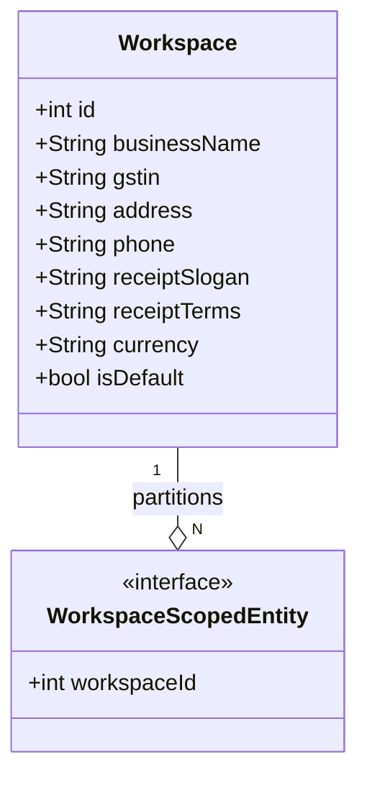
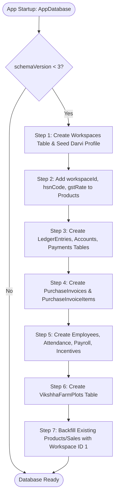

# Darvi Billing: Target Architecture & Migration Blueprint

**Document ID:** `docs/darvi-audit/DARVI_MIGRATION_ARCHITECTURE.md`  
**Audit Date:** November 2026  
**Auditor:** Senior Flutter Architect & Software Auditor  

---

## 1. System Vision & Architecture Principles

**Darvi Billing** transforms QuickStock POS from a simple single-store retail demo into an enterprise-ready, offline-first business suite for agricultural supply and retail enterprises.

### Core Architectural Tenets:
1. **Preserve What Works:** Retain the Drift ORM, BLoC/Cubit pattern, GoRouter shell navigation, and responsive POS layout.
2. **True Offline-First Reliability:** All business transactions (sales, purchases, expenses, attendance, incentives) execute locally in SQLite inside ACID transactions.
3. **Multi-Workspace Isolation:** Support multiple independent business identities and agricultural branches within a single app installation, completely eliminating hardcoded store identities.
4. **Hardware Direct Access:** Direct native Bluetooth Classic communication with the **SSEZNIK2POS** 58mm thermal printer using raw ESC/POS commands without third-party cloud services.
5. **Double-Entry Ledger Integrity:** Replace flat, in-place balance updates with immutable ledger entries for customers, suppliers, and cash/bank accounts.

---

## 2. Target Layered Architecture

```mermaid
graph TD
    subgraph 1. Presentation Layer
        Shell[Darvi Navigation Shell & Drawer]
        POS[POS Billing & Quick Checkout]
        InventoryUI[Product Catalog, Batches & HSN]
        LedgerUI[Customer & Supplier Ledgers]
        PurchaseUI[Multi-Item Purchase Bills]
        ExpenseUI[Expense Tracking & Accounts]
        StaffUI[Staff Directory, Attendance & Payroll]
        IncentiveUI[Target Setup & Commission Claims]
        VikshhaUI[Vikshha Farm Plot Management]
        HardwareUI[Bluetooth Scanner & 58mm Thermal Printer]
    end

    subgraph 2. Business Logic Layer / Cubits
        PosCubit
        ProductsCubit
        InvoicesCubit
        CustomerLedgerCubit
        SupplierLedgerCubit
        PurchaseCubit
        ExpenseCubit
        StaffCubit
        IncentiveCubit
        PrinterCubit
        WorkspaceCubit
    end

    subgraph 3. Domain Layer
        Entities[Pure Dart Domain Entities]
        Contracts[Abstract Repository & Service Contracts]
        MathEngine[MoneyCalculator + GST 3-Tier Tax Engine]
        IncentiveEngine[Commission & Target Calculator]
    end

    subgraph 4. Data Layer & Hardware
        Repos[Modular Repositories: Sales, Ledger, Staff, Purchases, etc.]
        DB[(Drift SQLite Database: Schema Version 3)]
        BT[Bluetooth Classic SPP Streamer: 256B Chunks]
        ESC[ESC/POS Byte Formatter: 32-Column 58mm Engine]
    end

    Presentation Layer --> Business Logic Layer
    Business Logic Layer --> Domain Layer
    Domain Layer --> Data Layer & Hardware
```

---

## 3. Multi-Workspace Isolation Architecture

To prevent hardcoding business details into business logic while supporting Darvi Group Agri Tech as the primary identity:



1. **`Workspaces` Table:**
   - Pre-seeded with **Darvi Group Agri Tech**:
     - `businessName`: "Darvi Group Agri Tech"
     - `address`: "#2 Totad Building, Arjun Vihar, Gokul Road, Hubli, Karnataka 580030, India"
     - `gstin`: "29BKZPA0053M1ZQ"
     - `phone`: "9986890777"
     - `receiptSlogan`: "Improving Agriculture, Improving lives."
     - `receiptTerms`: "* Goods once sold will not be taken back or exchanged.\n* No cash payments accepted."
     - `currency`: "INR" (₹)
2. **Query Filtering by Workspace:**
   - Every entity (`Products`, `Sales`, `Purchases`, `Customers`, `Suppliers`, `LedgerEntries`, `Employees`) includes a `workspaceId` foreign key.
   - All repository queries filter by the active workspace session:
     ```dart
     select(products)..where((tbl) => tbl.workspaceId.equals(currentWorkspaceId))
     ```

---

## 4. Database Schema Migration Plan (v2 -> v3)



### Migration Code Blueprint in `AppDatabase`:
```dart
@override
int get schemaVersion => 3;

@override
MigrationStrategy get migration => MigrationStrategy(
  onCreate: (m) => m.createAll(),
  onUpgrade: (m, from, to) async {
    if (from < 2) {
      await m.addColumn(products, products.imagePath);
    }
    if (from < 3) {
      // 1. Create new core tables
      await m.createTable(workspaces);
      await m.createTable(ledgerEntries);
      await m.createTable(accounts);
      await m.createTable(payments);
      await m.createTable(purchaseInvoices);
      await m.createTable(purchaseInvoiceItems);
      await m.createTable(employees);
      await m.createTable(attendance);
      await m.createTable(salesTargets);
      await m.createTable(incentiveRules);
      await m.createTable(incentiveClaims);
      await m.createTable(payrollRecords);
      await m.createTable(vikshhaFarmPlots);

      // 2. Add columns to existing tables
      await m.addColumn(products, products.workspaceId);
      await m.addColumn(products, products.hsnCode);
      await m.addColumn(products, products.gstRate);

      await m.addColumn(sales, sales.workspaceId);
      await m.addColumn(sales, sales.employeeId);
      await m.addColumn(sales, sales.cgstTotal);
      await m.addColumn(sales, sales.sgstTotal);
      await m.addColumn(sales, sales.igstTotal);
      await m.addColumn(sales, sales.roundOff);

      await m.addColumn(customers, customers.workspaceId);
      await m.addColumn(customers, customers.gstin);
      await m.addColumn(customers, customers.address);

      await m.addColumn(suppliers, suppliers.workspaceId);
      await m.addColumn(suppliers, suppliers.gstin);
      await m.addColumn(suppliers, suppliers.address);
      await m.addColumn(suppliers, suppliers.balance);

      // 3. Seed Darvi Primary Workspace and backfill existing rows
      await customStatement('''
        INSERT INTO workspaces (id, business_name, gstin, address, phone, receipt_slogan, receipt_terms, currency, is_default)
        VALUES (1, 'Darvi Group Agri Tech', '29BKZPA0053M1ZQ', 
                '#2 Totad Building, Arjun Vihar, Gokul Road, Hubli, Karnataka 580030, India', 
                '9986890777', 'Improving Agriculture, Improving lives.', 
                'Goods once sold will not be taken back or exchanged.\nNo cash payments accepted.', 'INR', 1);
      ''');

      await customStatement('UPDATE products SET workspace_id = 1 WHERE workspace_id IS NULL;');
      await customStatement('UPDATE sales SET workspace_id = 1 WHERE workspace_id IS NULL;');
      await customStatement('UPDATE customers SET workspace_id = 1 WHERE workspace_id IS NULL;');
      await customStatement('UPDATE suppliers SET workspace_id = 1 WHERE workspace_id IS NULL;');
    }
  },
);
```

---

## 5. Thermal Printing Subsystem Architecture

To guarantee reliable operation with the **SSEZNIK2POS** printer:

1. **Hardware Driver:** A dedicated Dart driver utilizing Bluetooth Classic SPP socket communication.
2. **Buffer Pacing:** Handheld POS printers have small receive buffers (often 512B - 1KB). Transmit data in **256-byte chunks** with a 20ms pause between chunks.
3. **ESC/POS Command Mapping:**
   - Initialize: `[0x1B, 0x40]`
   - Center Align: `[0x1B, 0x61, 0x01]`
   - Left Align: `[0x1B, 0x61, 0x00]`
   - Bold On/Off: `[0x1B, 0x45, 0x01]` / `[0x1B, 0x45, 0x00]`
   - Font Size Normal: `[0x1D, 0x21, 0x00]`
   - Paper Feed & Cut: `[0x1B, 0x64, 0x03, 0x1D, 0x56, 0x42, 0x00]`
4. **State Machine:**
   `Disconnected -> Scanning -> Connecting -> Connected -> Printing -> Idle`.

