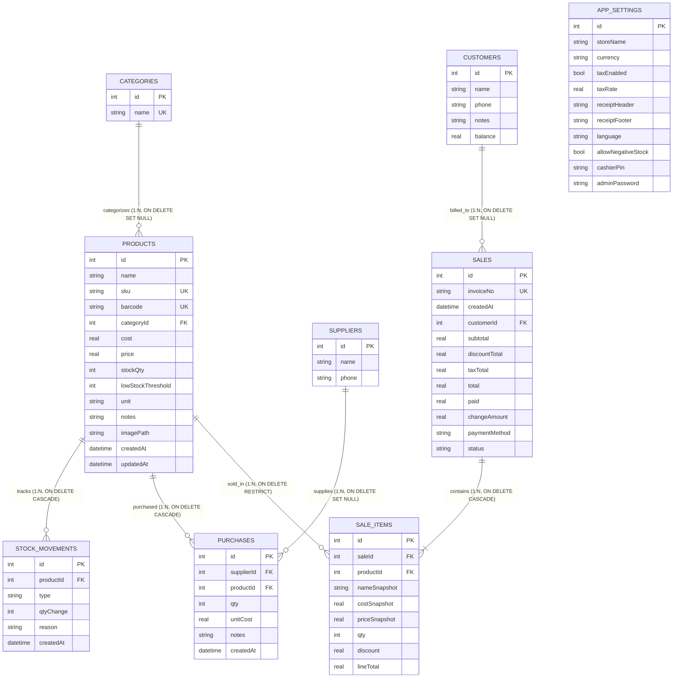

# QuickStock POS Source Code Audit: Database Relationships & Data Integrity

**Document ID:** `docs/darvi-audit/DATABASE_RELATIONSHIPS.md`  
**Audit Date:** November 2026  
**Auditor:** Senior Database Architect & Software Auditor  

---

## 1. Existing Entity Relationship Diagram



---

## 2. Answers to the 10 Data Integrity Questions

| # | Integrity Question | Status in Existing Code | Evidence & Analysis |
|---|---|---|---|
| **1** | **Can an invoice contain multiple products?** | **YES** | `SaleItems` table references `Sales(id)` with a `1:N` foreign key. An invoice can contain arbitrary lines. |
| **2** | **Can a customer have multiple invoices?** | **YES** | `Sales.customerId` references `Customers(id)` with a `1:N` foreign key (`ON DELETE SET NULL`). |
| **3** | **Can an invoice have multiple payment records?** | **NO** | There is no `Payments` table. Payment details are stored as flat columns on `Sales` (`paid`, `changeAmount`, `paymentMethod`). Split payments simply set `paymentMethod = 'split'` without tracking breakdown. |
| **4** | **Are payments connected to accounts?** | **NO** | There is no `Accounts` entity (no Cash Drawer, Bank Account, or UPI account). Money received is not allocated to any financial account. |
| **5** | **Are stock movements recorded separately?** | **PARTIAL** | Sales and manual adjustments insert into `StockMovements`. However, editing a product in `ProductsPage` directly overwrites `Products.stockQty` without inserting a movement record. |
| **6** | **Can purchases update inventory correctly?** | **PARTIAL** | `addStockMovement(type: purchase)` updates stock and inserts into `Purchases`. However, each purchase record accommodates only a single product. Multi-product supplier purchases are unsupported. |
| **7** | **Are returns represented correctly?** | **DEFICIENT** | Returns create a new `Sales` record with negative line items, but marking any item as returned marks the entire original invoice as `returned`. Customer balance and refunds are not adjusted. |
| **8** | **Are customer & supplier balances derived consistently?** | **NO** | Customer balance is modified in-place on the customer row. There is no ledger or transaction history to verify or audit how a balance was calculated. Suppliers have no balance column at all. |
| **9** | **Are database transactions used for multi-step operations?** | **YES** | Both `checkout` and `returnItems` are wrapped in `_db.transaction(() async { ... })`. |
| **10**| **Can multiple business workspaces be isolated?** | **NO** | Zero multi-workspace capability. All data belongs to a single global store. |

---

## 3. Critical Data Integrity Risks in Existing Codebase

1. **Race Condition in Invoice Number Generation:**
   In `LocalSalesRepository._nextInvoiceNo` (lines 636-646):
   ```dart
   final countExp = _db.sales.id.count();
   final query = _db.selectOnly(_db.sales)
     ..addColumns([countExp])
     ..where(_db.sales.invoiceNo.like('INV-$datePart-%'));
   final count = (await query.getSingleOrNull())?.read(countExp) ?? 0;
   final sequence = (count + 1).toString().padLeft(4, '0');
   ```
   If two devices checkout concurrently, or if an invoice is deleted, `count + 1` produces an identical sequence number, throwing a SQLite unique constraint violation and aborting the sale.
2. **Orphaned Debt:**
   Walk-in retail sales without a customer ID can be submitted with `paid < total`, causing debt to vanish.
3. **Double Stock Overwrite Flaw:**
   When multiple lines in the cart share the same product ID, inventory is subtracted from the pre-loop snapshot, causing previous deductions to be overwritten and lost.

---

## 4. Minimum Database Changes Required for Darvi Billing

To support Darvi Billing safely, the database must be upgraded to **Schema Version 3** with the following structural additions:

1. **`Workspaces` Table:**
   - Multi-tenant boundary (`id`, `businessName`, `gstin`, `address`, `phone`, `logoPath`, `isDefault`).
   - Add `workspaceId` foreign key to `Products`, `Sales`, `Purchases`, `Customers`, `Suppliers`, `AppSettings`.
2. **`LedgerEntries` Table:**
   - Replacing flat balance columns with a double-entry / audit ledger (`id`, `workspaceId`, `partyType`, `partyId`, `date`, `entryType`, `debit`, `credit`, `balanceAfter`, `referenceType`, `referenceId`, `notes`).
3. **`Accounts` & `Payments` Tables:**
   - Financial accounts (`Cash`, `Bank`, `UPI`) and payment transactions linked to invoices and bills.
4. **`PurchaseInvoices` & `PurchaseInvoiceItems` Tables:**
   - True multi-item purchase bills matching supplier invoices.
5. **`Employees`, `Attendance`, `Payroll`, and `Incentives` Tables:**
   - Enterprise workforce and commission management.

