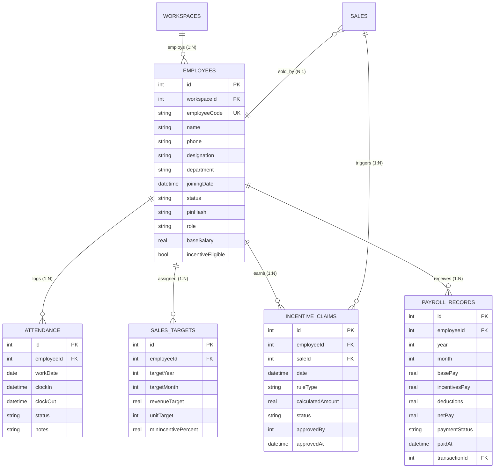

# QuickStock POS Source Code Audit: Employee & Incentive Gap Analysis

**Document ID:** `docs/darvi-audit/EMPLOYEE_INCENTIVE_GAP_ANALYSIS.md`  
**Audit Date:** November 2026  
**Auditor:** Senior Flutter Architect & Software Auditor  

---

## 1. Executive Summary

A thorough review of the QuickStock POS repository confirms that **no employee or incentive functionality exists**.

The application currently operates with a rudimentary two-credential authentication model hardcoded into `AppSettings`:
- A single Cashier PIN (default `1234`)
- A single Admin Password (default `admin123`)

There are **zero database tables, zero models, zero repository methods, zero cubits, and zero UI screens** for staff profiles, employee identification, attendance, salary structures, payroll, sales targets, or performance incentives.

To fulfill Darvi Billing's requirements, a dedicated **Human Capital & Incentive Subsystem** must be architected from the ground up and seamlessly integrated with the POS sales engine and financial ledgers.

---

## 2. Requirement Classification Matrix

| Feature Requirement | Existing Status | DB Required | Logic Required | UI Required | Detailed Architectural Assessment |
|---|---|---|---|---|---|
| **Employee Profiles** | **MISSING** | New Table (`Employees`) | New Repository | New CRUD Screen | Requires storing photo, full name, employee ID, phone, email, address, emergency contact. |
| **Employee ID System** | **MISSING** | In `Employees` | Sequence Generator | Form field | Auto-generated alphanumeric format (e.g., `DRV-EMP-001`). |
| **Department & Designation** | **MISSING** | In `Employees` | Validation | Form dropdowns | Store Sales, Agronomy Specialist, Billing Clerk, Store Manager, Delivery. |
| **Joining Date & Status** | **MISSING** | In `Employees` | Date logic | Date pickers | Active, On Leave, Resigned, Terminated. |
| **Salary Configuration** | **MISSING** | New Table (`SalaryConfigs`)| Wage calculation | Config modal | Base salary (monthly/daily), allowances, PF/ESI deductions, incentive eligible flag. |
| **Individual Login Accounts** | **MISSING** | In `Employees` | Auth Provider | Login PIN pad | Each employee must have a unique 4-6 digit login PIN and optional biometric hash. |
| **Role-Based Permissions** | **INCOMPLETE** | New Table (`Roles`) | Permission Engine | Admin toggle UI | QuickStock only has hardcoded `UserRole { admin, cashier }`. Darvi requires granular capabilities (`canGiveDiscount`, `canEditPrice`, `canViewCost`, `canIssueRefund`, `canViewReports`). |
| **Daily Attendance** | **MISSING** | New Table (`Attendance`) | Shift tracking | Check-in/out UI | Clock-in, clock-out, break tracking, total working hours, geo-fence / WiFi tag. |
| **Leave Management** | **MISSING** | New Table (`EmployeeLeaves`)| Balance tracking | Leave approval UI| Paid leave, sick leave, casual leave, approval workflow. |
| **Payroll Processing** | **MISSING** | New Table (`Payrolls`) | Salary calculation | Payroll run UI | Monthly payroll generator calculating gross pay, attendance deductions, incentives earned, advances, and net pay. |
| **Salary Payments** | **MISSING** | In `LedgerEntries` | Ledger integration | Payment voucher | Direct integration with Cash/Bank accounts; generates payment receipt voucher. |
| **Salesperson Attribution** | **MISSING** | Alter `Sales` table | POS Cubit | POS attribution UI | Each sale must record `employeeId` of the staff member who served the customer. |
| **Sales Target Configuration**| **MISSING** | New Table (`SalesTargets`)| Target engine | Target setup UI | Monthly sales quota (by revenue volume or unit count) per employee or department. |
| **Percentage-Based Commission**| **MISSING** | In `IncentiveRules` | Commission math | Rule builder UI | E.g., 1.5% of total sales revenue generated. |
| **Product-Specific Incentives**| **MISSING** | In `IncentiveRules` | Rule matching | Product tag UI | High-margin agricultural products (fertilizers, specialized seeds) offering fixed ₹ per unit sold. |
| **Target Achievement Tracking**| **MISSING** | Virtual Calculation | Real-time aggregate | Target gauge UI | Live calculation of % quota achieved in current billing cycle. |
| **Incentive Approval Workflow**| **MISSING** | In `IncentiveClaims` | State machine | Approval screen | Pending -> Approved by Store Manager -> Disbursed into Payroll. |
| **Incentive Performance Reports**| **MISSING**| Query Views | Aggregations | Staff analytics | Leaderboards, staff sales charts, commission earned vs paid out. |

---

## 3. Scalable Target Architecture for Darvi Staff & Incentives

### Business Logic Hook into POS Checkout
When an invoice is finalized in `LocalSalesRepository.checkout`, Darvi Billing will execute an asynchronous post-checkout hook:
1. Identify the selling staff member (`input.employeeId`).
2. Query active incentive rules:
   - Calculate line-level product incentives (e.g. ₹50 per bag of organic fertilizer).
   - Calculate order-level revenue percentage (e.g. 2% on bills exceeding ₹10,000).
3. Insert pending `IncentiveClaims` records referencing the `saleId`.
4. Update employee real-time achievement progress against monthly quota.

