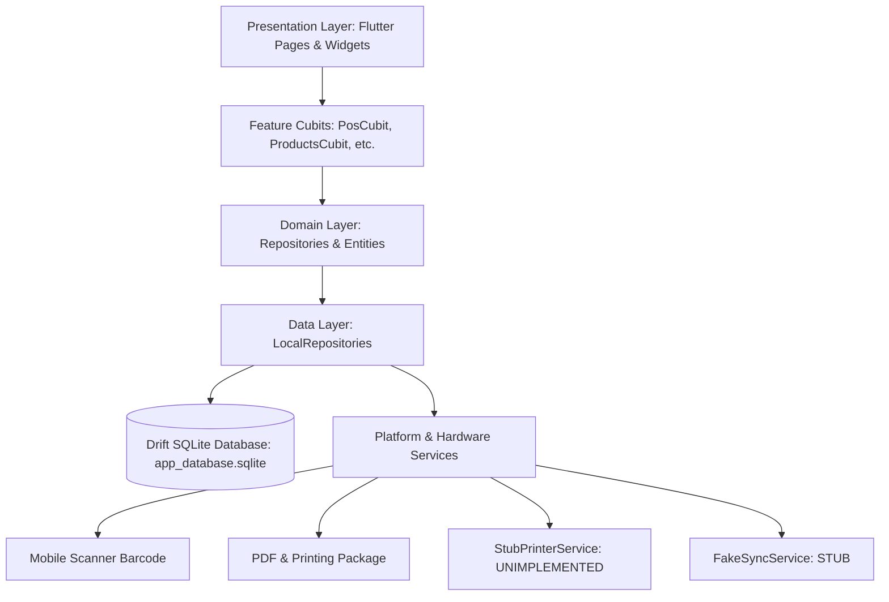

# QuickStock POS Source Code Audit & Darvi Billing Migration: Project Overview

**Document ID:** `docs/darvi-audit/PROJECT_OVERVIEW.md`  
**Audit Date:** November 2026  
**Auditor:** Senior Flutter Architect & Software Auditor  
**Upstream Repository:** [Mini-POS-Inventory-Flutter (AmrNabil12)](https://github.com/AmrNabil12/Mini-POS-Inventory-Flutter)  
**Target Application:** **Darvi Billing** — Professional Business Management, Billing, Inventory, Accounting, Employee and Incentive Management System.

---

## 1. Executive Summary

QuickStock POS is an open-source, offline-first Point of Sale and Inventory MVP built using Flutter 3.x, `flutter_bloc` (Cubit), `go_router`, and `drift` (SQLite). 

The application is structured around a retail counter-top use case with basic offline data persistence, local authentication via PIN/password, product cataloging, a mobile-oriented POS screen, invoice history, reports, and basic receipt generation.

While the README claims support for Customer Ledgers, Supplier records linked to purchases, and Bluetooth receipt printing, an in-depth source code audit reveals that **several critical business modules are either stubs, incomplete, or entirely missing from the user interface and routing architecture**.

This audit report serves as the technical blueprint for safely migrating and extending QuickStock POS into **Darvi Billing**, an enterprise-grade multi-workspace platform tailored for agricultural business management, GST compliance, comprehensive ledger accounting, employee payroll, target incentives, and direct thermal printing on Android POS terminals.

---

## 2. Upstream Project Metadata

| Attribute | Upstream Value | Audit Finding |
|---|---|---|
| **Package Name** | `mini_pos_inventory` | Declared in `pubspec.yaml` |
| **Android Application ID** | `com.example.mini_pos_inventory` | Configured in `android/app/build.gradle.kts` |
| **Declared SDK Constraint** | `sdk: ^3.10.4` | Invalid Dart constraint; anomalous environment config |
| **State Management** | BLoC / Cubit | `flutter_bloc: ^9.1.1` |
| **Navigation** | GoRouter | `go_router: ^17.1.0` |
| **Database ORM** | Drift (SQLite) | `drift: ^2.21.0` (locked to `2.31.0`) |
| **Code Generation** | Drift Dev + Build Runner | `drift_dev: ^2.21.2`, `build_runner: ^2.4.13` |
| **Default Currency** | `EGP` (Egyptian Pound) | Hardcoded default across formatting and database seed |
| **Database Schema Version**| `2` | Upgraded once to add `imagePath` to `Products` table |

---

## 3. High-Level Architecture Assessment

The application adheres to a **feature-first clean architecture pattern**:
1. **Presentation Layer (`lib/features/`)**: Separated by feature (`auth`, `pos`, `products`, `reports`, `invoices`, `settings`, `shared`, `shell`).
2. **Domain Layer (`lib/domain/`)**: Pure Dart entities (`app_entities.dart`) and abstract repository contracts (`repositories.dart`).
3. **Data Layer (`lib/data/`)**: SQLite tables and Drift database definition (`lib/data/local/db/`), repository implementations (`lib/data/repositories/local_repositories.dart`), and initial seed data (`lib/data/local/seed/`).
4. **Core Layer (`lib/core/`)**: Cross-cutting concerns, localized strings, money calculator, shared reusable widgets, and service abstractions.

---

## 4. Summary of Functional Capabilities vs. Critical Gaps

### What Genuinely Works
- **Product Management:** Full CRUD operations for products (name, SKU, barcode, category assignment, cost, price, stock quantity, low-stock threshold, unit, notes, and local/remote image URLs).
- **POS Cart & Sale Execution:** Adding products by search or barcode scan, adjusting line item quantities, line item discounts, price overrides (admin only), order discount, tax calculation, payment collection (cash/card/split), and change calculation.
- **Invoice Generation & PDF:** Persisting invoices and line items into SQLite with date-stamped numbering (`INV-YYYYMMDD-XXXX`), generating thermal-styled 80mm PDF receipts, and sharing via system share sheet or invoking OS print dialog.
- **Sales Return:** Selecting an invoice, selecting return quantities per line item, restocking inventory, generating return invoice records (`RET-YYYYMMDD-XXXX`), and adjusting sales status.
- **Local Role Authentication:** Single-cashier PIN login and single-admin password login stored in settings.
- **Basic Reporting:** Today/Month revenue, Today/Month profit, top 5 best sellers, sales by product breakdown, low stock product alerts, date range filtering, and CSV export.

### What is Incomplete, Defective, or Missing
1. **Missing Business Modules from Navigation & UI:**
   - Although `Customers`, `Suppliers`, and `Purchases` exist in the Drift schema and repository contracts, **no UI pages or routes exist for them**. There is no customer management screen, no supplier management screen, and no purchase creation screen.
2. **Single-Item Purchase Limitation:**
   - The `Purchases` table is designed to store only one product per purchase record. There is no concept of a multi-item purchase bill or supplier invoice.
3. **Absence of Customer/Supplier Transaction Ledgers:**
   - Customer balance is updated in-place via `customer.balance + (total - paid)`. There is **no ledger table**, no transaction history, no payment-in/payment-out records, and no audit trail. Suppliers do not even possess a balance column.
4. **Thermal Printing is a Stub:**
   - `StubPrinterService` is completely empty. `ReceiptPdfService.printThroughStub()` does nothing. The app only calls `Printing.layoutPdf()`, which invokes the standard Android system print dialog instead of direct ESC/POS thermal printing over Bluetooth.
5. **No Employee, Payroll, or Incentive Management:**
   - The codebase has zero models, tables, business logic, or UI for employees, staff attendance, payroll, sales targets, commissions, or incentives.
6. **No Accounting / Cash & Bank Accounts:**
   - There are no cash drawers, bank accounts, UPI accounts, or expense tracking entities.
7. **No Multi-Workspace Support:**
   - The database is strictly single-tenant. All tables lack a `workspaceId` or `businessId`.
8. **Critical POS State Bug:**
   - In `PosCubit`, when cart items are updated or added, `paid` is assigned from the *previous* state's total (`state.total`) before the new state is emitted, causing payment discrepancies.
9. **In-Memory Query Bottlenecks:**
   - Reports and metrics fetch entire database tables into Dart memory (`_db.select(_db.sales).get()`, `_db.select(_db.saleItems).get()`) and filter with Dart `Iterable.where()`, which will cause severe performance degradation as database size grows.

---

## 5. Strategic Migration Path to Darvi Billing

To transform QuickStock POS into **Darvi Billing** without destabilizing functioning features:
1. **Preserve & Harden:** Retain the Drift ORM, BLoC/Cubit pattern, GoRouter shell navigation, and core POS cart UI, while resolving floating-point calculation anomalies and state bugs.
2. **Database Schema Evolution (v2 -> v3):** Add multi-workspace tenancy, customer/supplier ledgers, payment transactions, multi-item purchase bills, expenses, cash/bank accounts, employees, payroll, and incentive tracking.
3. **Hardware Engine Integration:** Replace `StubPrinterService` with an Android Bluetooth ESC/POS engine supporting the SSEZNIK2POS printer (58mm, 32-column).
4. **UI Expansion:** Introduce dedicated views for Ledgers, Purchases, Expenses, Staff, Incentives, and CRM Leads.

