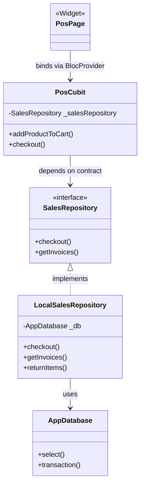

# QuickStock POS Source Code Audit: Technology & Architecture Audit

**Document ID:** `docs/darvi-audit/TECHNOLOGY_STACK.md`  
**Audit Date:** November 2026  
**Auditor:** Senior Flutter Architect & Software Auditor  

---

## 1. Actual Versions & Implementations

The audit compared the declared dependency constraints in `pubspec.yaml` with the resolved lockfile entries in `pubspec.lock`:

| Component / Library | Constraint in `pubspec.yaml` | Resolved in `pubspec.lock` | Implementation Category | Evaluation & Active Status |
|---|---|---|---|---|
| **Flutter SDK** | `sdk: flutter` | `>=3.38.4` (lockfile tag) | Framework | Material 3 enabled (`useMaterial3: true`). UI components use Material 3 chips, filled buttons, navigation bars, and cards. |
| **Dart SDK** | `^3.10.4` | `>=3.10.4 <4.0.0` | Language | **Anomaly**: Dart 3.10 does not exist in standard stable releases (stable Dart is 3.0 to 3.7). This constraint appears to confuse Flutter version 3.10 with Dart versioning. |
| **`flutter_bloc`** | `^9.1.1` | `9.1.1` | State Management | Actively used across `AppCubit`, `PosCubit`, `ProductsCubit`, `ReportsCubit`, and `InvoiceDetailCubit`. |
| **`equatable`** | `^2.0.7` | `2.0.7` | Value Equality | Actively used in all domain entities, states, and models. |
| **`go_router`** | `^17.1.0` | `17.1.0` | Routing & Deep Linking | Actively used with `ShellRoute`, `GoRouterRefreshStream`, and authentication redirects. |
| **`drift`** | `^2.21.0` | `2.31.0` | SQLite ORM | Core local storage engine. Defines 9 tables, queries, companions, and type-safe schema versioning. |
| **`sqlite3_flutter_libs`** | `^0.5.24` | `0.5.39` | SQLite Native Binaries | Provides embedded SQLite C-library binaries for Android/iOS. |
| **`path_provider`** | `^2.1.4` | `2.1.5` | Filesystem Access | Used to locate SQLite database path and documents directory for PDF/CSV storage. |
| **`path`** | `^1.9.0` | `1.9.1` | Path Manipulation | Path joining utility for file operations. |
| **`collection`** | `^1.19.0` | `1.19.1` | Collections Utilities | Used for `firstOrNull` lookups. |
| **`pdf`** | `^3.11.1` | `3.11.3` | Document Generation | Generates 80mm PDF thermal receipts with vector canvas. |
| **`printing`** | `^5.13.4` | `5.14.2` | Print Preview / Dialog | Invokes OS native print dialog via `Printing.layoutPdf()`. |
| **`share_plus`** | `^10.1.2` | `10.1.4` | OS Share Intent | Used to share generated PDF invoices and CSV reports. |
| **`csv`** | `^6.0.0` | `6.0.0` | Data Serialization | Used in `FileExportService` to serialize sales and stock reports. |
| **`fl_chart`** | `^0.69.2` | `0.69.2` | Charts & Graphs | **Unused**: Present in `pubspec.yaml` and `pubspec.lock`, but never imported in any source file under `lib/`. Reports screen uses native `LinearProgressIndicator` instead of `fl_chart`. |
| **`mobile_scanner`** | `^6.0.2` | `6.0.11` | Barcode & QR Reader | Actively used in `BarcodeScannerPage` via camera feed. |
| **`uuid`** | `^4.5.1` | `4.5.1` | Unique Identifiers | **Unused**: Present in `pubspec.yaml`, but never imported in `lib/`. The app generates invoice IDs using date strings and SQL row counts (`INV-YYYYMMDD-XXXX`). |
| **`image_picker`** | `^1.2.1` | `1.2.1` | Camera / Gallery Picker | Actively used in `ProductsPage` to pick local product photos. |
| **`intl`** | `^0.20.2` | `0.20.2` | Formatting / I18n | Used for `NumberFormat.currency()` and `DateFormat`. |
| **`flutter_lints`** (dev) | `^6.0.0` | `6.0.0` | Linter | Standard Flutter lint rules configured in `analysis_options.yaml`. |
| **`drift_dev`** (dev) | `^2.21.2` | `2.31.0` | Drift Code Generator | Generates `app_database.g.dart`. |
| **`build_runner`** (dev) | `^2.4.13` | `2.4.15` | Code Generation Runner | Orchestrates Drift code generation. |

---

## 2. Platform & Toolchain Configuration (Android)

| Setting | Value in Repo | Evaluation |
|---|---|---|
| **Android Gradle Plugin (AGP)** | `8.11.1` (in `android/settings.gradle.kts`) | Modern Gradle plugin using Kotlin DSL (`.kts`). |
| **Gradle Distribution** | `8.14-all.zip` (in `gradle-wrapper.properties`) | Latest stable Gradle 8 distribution. |
| **Kotlin Plugin** | `2.2.20` | Modern Kotlin compiler version. |
| **Java Compatibility** | `JavaVersion.VERSION_17` | Standard modern Java target for Android 14+ support. |
| **Namespace** | `com.example.mini_pos_inventory` | Default sample namespace; must be updated to `com.darvi.billing` during migration. |
| **Android Permissions** | None in `AndroidManifest.xml` | **Critical Defect**: Neither `CAMERA` nor any Bluetooth permissions (`BLUETOOTH_CONNECT`, `BLUETOOTH_SCAN`) are declared in `android/app/src/main/AndroidManifest.xml`. While `mobile_scanner` library merges its own camera permissions, Bluetooth printing will strictly fail on Android 12+ without explicit runtime permissions. |

---

## 3. Dependency Anomalies & Missing Assets

### A. The SDK Constraint Bug
In `pubspec.yaml`:
```yaml
environment:
  sdk: ^3.10.4
```
In Dart, version numbers follow Semantic Versioning (e.g. `3.0.0`, `3.3.0`, `3.7.0`). There is no public Dart SDK `3.10.4`. Standard stable Flutter 3.27 ships with Dart 3.6. Attempting to run `flutter pub get` on a standard Flutter stable environment with this constraint will trigger an SDK incompatibility error:
`The current Dart SDK version is 3.x.x. Because mini_pos_inventory requires SDK version ^3.10.4, version solving failed.`
*Recommendation:* Normalize SDK constraint to `sdk: '>=3.3.0 <4.0.0'`.

### B. Missing `assets/` Directory
In `pubspec.yaml`:
```yaml
flutter:
  generate: true
  uses-material-design: true
  assets:
    - assets/
```
The file system audit verified via `Test-Path assets` that **no `assets/` directory exists in the repository**. Running `flutter pub get` or building on certain Flutter versions will warn or fail on a declared asset folder that does not exist on disk.

---

## 4. Architecture Pattern Review



### Strengths
1. **Clean Separation of Domain Contracts:** `ProductRepository`, `SalesRepository`, `PartyRepository`, and `ReportsRepository` are well-defined abstract interfaces. Presentation components do not import `drift` directly.
2. **Predictable State Flow:** Cubits provide predictable unidirectional state management with immutable states extending `Equatable`.
3. **Inherited Dependency Injection:** `AppScope` cleanly supplies `AppDependencies` without introducing bulky third-party service locators.

### Architectural Weaknesses
1. **Repository Monolith (`local_repositories.dart`):** At 893 lines and 29 KB, `local_repositories.dart` bundles six separate repository implementations into a single file. This creates tight coupling and makes unit testing difficult.
2. **Leaky Money Calculations in Cubits:** While `MoneyCalculator` exists, `PosCubit` re-computes `subtotal`, `tax`, and `total` inside its own getters, duplicating calculation logic between the domain and presentation layers.
3. **Database Single-Tenancy:** Zero multi-workspace awareness across database tables.
4. **Lack of Hardware Abstraction Layer for Printing:** No ESC/POS byte streaming abstraction exists.

