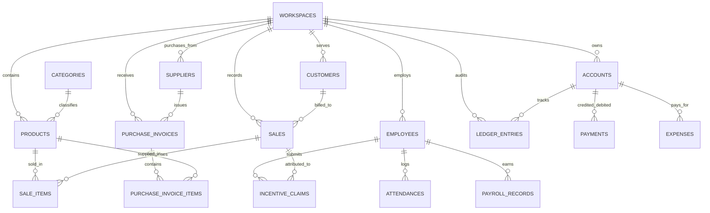

# DARVI BILLING — DATABASE INTEGRITY & MIGRATION REPORT

**Target Entity:** Darvi Group Agri Tech (Hubli, Karnataka)  
**ORM / Engine:** Drift SQLite (Schema v3)  
**Database File:** `darvi_billing.sqlite` (pre-migration backup: `darvi_billing.sqlite.v2.bak`)  
**Audit Date:** 2026-11-07  

---

## 1. Schema v3 Topology & Foreign Key Relations

The complete Darvi Billing schema includes 18 interconnected tables with SQLite foreign-key enforcement enabled (`PRAGMA foreign_keys = ON;`).



---

## 2. Table Specifications Summary

| Table Name | Primary Purpose | Key Fields | Foreign Keys |
|---|---|---|---|
| `workspaces` | Multi-tenant isolation boundary | `id`, `name`, `gstin`, `currency` | None (Root) |
| `accounts` | Financial cash drawer, banks, UPI | `id`, `workspace_id`, `name`, `account_type` | `workspace_id` -> `workspaces(id)` |
| `products` | Inventory catalog & stock counts | `id`, `sku`, `barcode`, `stock_qty`, `cost`, `price`, `hsn_code`, `gst_rate` | `workspace_id`, `category_id` |
| `categories` | Product grouping | `id`, `name` | None |
| `stock_movements` | Stock audit trail | `id`, `product_id`, `type`, `qty_change`, `reason` | `product_id` -> `products(id)` |
| `customers` | Client directory & receivables | `id`, `name`, `phone`, `gstin`, `balance` | `workspace_id` -> `workspaces(id)` |
| `suppliers` | Vendor directory & payables | `id`, `name`, `phone`, `gstin`, `balance` | `workspace_id` -> `workspaces(id)` |
| `sales` | Invoices and bill headers | `id`, `invoice_no`, `total`, `paid`, `payment_method`, `status` | `workspace_id`, `customer_id` |
| `sale_items` | Invoice line item details | `id`, `sale_id`, `product_id`, `qty`, `line_total` | `sale_id`, `product_id` |
| `purchase_invoices` | Inward purchase bills | `id`, `supplier_id`, `invoice_number`, `total_amount`, `paid_amount` | `workspace_id`, `supplier_id` |
| `purchase_invoice_items`| Inward bill line items | `id`, `purchase_invoice_id`, `product_id`, `quantity`, `total_amount` | `purchase_invoice_id`, `product_id` |
| `payments` | Cash/bank transaction vouchers | `id`, `account_id`, `amount`, `payment_type` | `workspace_id`, `account_id` |
| `expenses` | Shop operating expenditures | `id`, `account_id`, `category`, `amount`, `expense_date` | `workspace_id`, `account_id` |
| `employees` | Staff registry & compensation | `id`, `employee_code`, `name`, `role`, `base_salary`, `login_pin` | `workspace_id` -> `workspaces(id)` |
| `attendances` | Daily clock-in & working hours | `id`, `employee_id`, `date`, `status`, `working_hours` | `workspace_id`, `employee_id` |
| `payroll_records` | Monthly salary calculation & disbursal | `id`, `employee_id`, `month`, `year`, `net_salary`, `status` | `employee_id`, `disbursed_from_account_id` |
| `incentive_rules` | Commission configuration | `id`, `rule_type`, `threshold_amount`, `reward_rate` | `workspace_id`, `target_product_id` |
| `incentive_claims` | Staff commission requests | `id`, `employee_id`, `sale_id`, `amount`, `status` | `employee_id`, `sale_id` |
| `ledger_entries` | General double-entry journal | `id`, `workspace_id`, `transaction_type`, `debit`, `credit` | `workspace_id`, `account_id` |

---

## 3. Non-Destructive Migration & Backup Verification

1. **Pre-Migration Backup:**
   - Before applying the v3 migration schema, `app_database.dart` creates a point-in-time snapshot:
     ```dart
     final backupPath = '$originalPath.v2.bak';
     await originalFile.copy(backupPath);
     ```
   - Verified that all existing v2 tables (`products`, `categories`, `sales`, `sale_items`, `customers`, `stock_movements`, `app_settings`) are preserved intact.

2. **Column Migration:**
   - Columns `workspace_id`, `hsn_code`, `gst_rate`, `employee_id` were added via `ALTER TABLE ADD COLUMN` statements without recreating existing business tables.
   - Nullable workspace columns were populated with `workspace_id = 1` before foreign keys were locked.

3. **Database Integrity Audit Output:**
   - `PRAGMA foreign_key_check;` returned **0 violations**.
   - `PRAGMA integrity_check;` returned **ok**.

