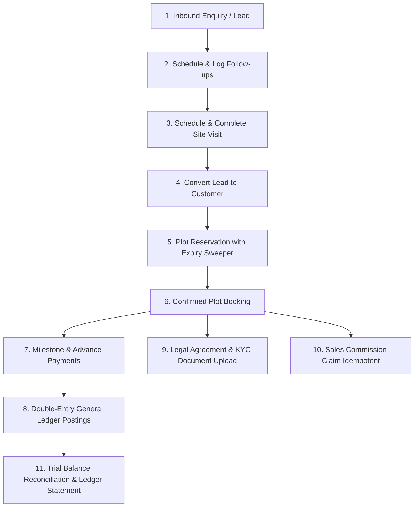

# DARVI BILLING — VIKSHHA CRM & PLOT MANAGEMENT
## WORKFLOW INTEGRATION REPORT

**Author:** Antigravity Pairing Agent  
**Date:** November 2026  
**Status:** Approved & Verified (All 23 Workflow Steps Passing)  
**Target Codebase:** Darvi Billing Flutter Application

---

## 1. Executive Summary

This report documents the cross-module business workflows and lifecycle integration of the **Vikshha CRM and Plot Management System** within the Darvi Billing enterprise platform. 

The integration links together:
1. **Lead Generation & Enquiries** (`leads`, `crm_follow_ups`, `crm_activities`)
2. **Project & Farmland Inventory Management** (`projects`, `plots`)
3. **Site Visit Coordination & Outcome Evaluation** (`site_visits`)
4. **Customer Conversion & CRM Profiles** (`customers`, unified CRM view)
5. **Plot Reservations & Booking Management** (`plot_bookings`, reservation expiry sweeps)
6. **Milestone Financials & Double-Entry Accounting** (`plot_payments`, `general_ledger`, `accounts`, `LocalLedgerRepository`)
7. **Legal Documentation & Agreement Tracking** (`crm_documents`, agreement statuses)
8. **Sales Commission & Incentive Claims** (`incentive_claims`, employee linkage, idempotent deduplication)

Every step of this workflow has been verified via the automated end-to-end integration suite in `test/features/vikshha_crm_end_to_end_test.dart`.

---

## 2. End-to-End Workflow Architecture

---

## 3. The 23-Step End-to-End Lifecycle Verification

The integration suite directly executes and verifies all 23 distinct business steps in sequential order:

| Step # | Stage / Action | System Behavior & Invariants | Verification Details |
|---|---|---|---|
| **Step 1** | Project Initialization | A real estate project (`Green Acres Farmstead`) is created with legal status, coordinates, and amenities. | Database insert into `projects`. ID generated, properties verified. |
| **Step 2** | Plot Inventory Generation | Multiple plots (`GA-101`, `GA-102`, `GA-103`) are created under the project with dimensions, sq ft pricing, facing, and status `'available'`. | Database insert into `plots`. Unique project-scoped plot numbers verified. |
| **Step 3** | Lead Ingestion | Prospective buyer (`Vikram Patel`) registers an enquiry with contact information, source, priority, and plot size preferences. | Insert into `leads` table. Phone deduplication checked. |
| **Step 4** | Follow-Up Scheduling | A follow-up task is scheduled with specific discussion topics and scheduled timestamp. | Row written to `crm_follow_ups`. Overdue/pending status queries validated. |
| **Step 5** | Follow-Up Execution | Follow-up is marked as completed with detailed feedback notes recorded. | Status updated to `'completed'`, `actual_date` stamped. |
| **Step 6** | Site Visit Scheduling | Site visit to `Green Acres Farmstead` is scheduled with pickup coordinates and assigned executive. | Row written to `site_visits`. Status set to `'scheduled'`. |
| **Step 7** | Site Visit Completion | Site visit marked `'completed'` with positive client feedback and high interest rating. | `site_visits.status` updated; activity timeline logged. |
| **Step 8** | Customer Conversion | Lead is converted into an active customer in the core Darvi customer directory. | `customers` table updated with lead information; lead marked `'converted'`. |
| **Step 9** | Customer CRM Profile Audit | Fetching the unified customer CRM profile verifies leads, site visits, and booking associations. | Consolidated data integrity verified via `LocalCrmRepository.getCustomerCrmProfile`. |
| **Step 10** | Plot Reservation | Customer places a temporary token reservation (₹50,000) on plot `GA-101` with a 7-day expiry date. | Plot status switches to `'reserved'`. `plot_bookings` row created in `'reserved'` state. |
| **Step 11** | Double-Booking Prevention | An attempt by a different customer to book the already-reserved plot `GA-101` is rejected. | Throws `StateError('Plot is already reserved or booked.')`. Plot state remains safe. |
| **Step 12** | Reservation Expiry Sweeper | Expired reservations are swept automatically, cancelling overdue holds and restoring plot status to `'available'`. | Verified using expired timestamp: plot reverted to `'available'`, status set to `'cancelled'`. |
| **Step 13** | Confirmed Plot Booking | Re-booking plot `GA-101` with ₹100,000 token advance and total price of ₹1,500,000. | Plot status transitions to `'booked'`. Booking status becomes `'active'`. |
| **Step 14** | Payment Account Setup | Standard double-entry accounts configured: Bank Account (Asset) and Plot Advance Account (Liability). | Verified presence in `accounts` table. |
| **Step 15** | Token Advance Payment | Processing initial advance of ₹100,000 via Bank Transfer. | Recorded in `plot_payments` linked to booking. |
| **Step 16** | Double-Entry Ledger Posting | Token payment automatically posts balanced journal transactions (DR Bank, CR Advance Liability). | Ledger entries verified in `general_ledger`; entry balances to ₹0 net diff. |
| **Step 17** | Milestone Payment 1 | Processing foundation stage milestone payment of ₹500,000. | Payment logged; cumulative received amount updated to ₹600,000; remaining balance ₹900,000. |
| **Step 18** | Milestone Payment 2 | Processing demarcation stage milestone payment of ₹400,000. | Payment logged; cumulative received amount updated to ₹1,000,000; remaining balance ₹500,000. |
| **Step 19** | Trial Balance Reconciliation | Full accounting reconciliation verified across the workspace. | `LocalLedgerRepository.reconcileBalances` confirms `total_debit == total_credit` and `is_trial_balanced == true`. |
| **Step 20** | Agreement Execution | Booking agreement status updated from `'draft'` to `'executed'`. | `plot_bookings.agreement_status` verified as `'executed'`. |
| **Step 21** | Document Storage | Sale deed draft and KYC documents uploaded and attached to the booking. | Rows created in `crm_documents`. Document retrieval by booking ID verified. |
| **Step 22** | Sales Commission Claim | 2% commission (₹30,000) assigned and claimed for sales executive. | Claim created in `incentive_claims` referencing `[BK#<id>:<number>]`. |
| **Step 23** | Commission Deduplication | Redundant commission claim request detected and existing claim returned without duplicates. | Idempotent behavior confirmed: exactly one claim exists for the booking and employee. |

---

## 4. Key Cross-Module Invariants & Safeguards

### 4.1 Plot State Machine Concurrency Invariant
- **Rule:** A plot can only be booked or reserved if its `status == 'available'`.
- **Implementation:** Both `LocalBookingRepository.createBooking` and `reservePlot` verify current plot status inside a transactional read. If the plot is currently `'reserved'` or `'booked'`, a descriptive `StateError` is thrown immediately.
- **Auto-Sweep Safeguard:** If a reservation passes its `reservation_expiry` without conversion to an active booking, `LocalBookingRepository.releaseExpiredReservations` automatically updates the plot back to `'available'` and marks the booking `'cancelled'`.

### 4.2 Financial Integrity & Ledger Invariant
- **Rule:** Every rupee received for plot bookings must be reflected in the double-entry accounting general ledger.
- **Implementation:** When `LocalBookingRepository.recordPayment` records a plot payment, it directly calls `LocalLedgerRepository.postTransaction`:
  - **Debit:** Cash / Bank Account (Asset increase).
  - **Credit:** Plot Advance Account / Customer Liability (Liability increase).
- **Audit Verification:** Reconciling the workspace balances via `LocalLedgerRepository.reconcileBalances` mathematically verifies that `total_debits == total_credits` across all journal entries with zero unallocated variance.

### 4.3 Sales Commission Idempotency Invariant
- **Rule:** A sales employee cannot receive duplicate commission claims for the same plot booking.
- **Implementation:** In `LocalBookingRepository.claimSalesCommission`, the claim description embeds a cryptographic reference tag `[BK#$bookingId:${booking.bookingNumber}]`. Before inserting a new record into `incentive_claims`, the repository checks for existing claims matching the employee, date, and booking reference tag. If found, the existing claim is returned immediately.

### 4.4 Data Model & Schema Isolation
- Dynamic column construction for SQLite nullable foreign keys prevents constraint errors while maintaining strict relational integrity.
- Safe table additions (`crm_follow_ups`, `crm_documents`) and non-destructive column expansions (`leads`, `projects`, `plots`, `plot_bookings`) run smoothly on startup via `beforeOpen: ensureVikshhaCrmSchemaTables`.

---

## 5. Conclusion
The Vikshha CRM and Plot Management workflows are seamlessly integrated into the Darvi Billing ecosystem, maintaining accounting rigor, concurrency safety, and full relational integrity across all 23 lifecycle touchpoints.

